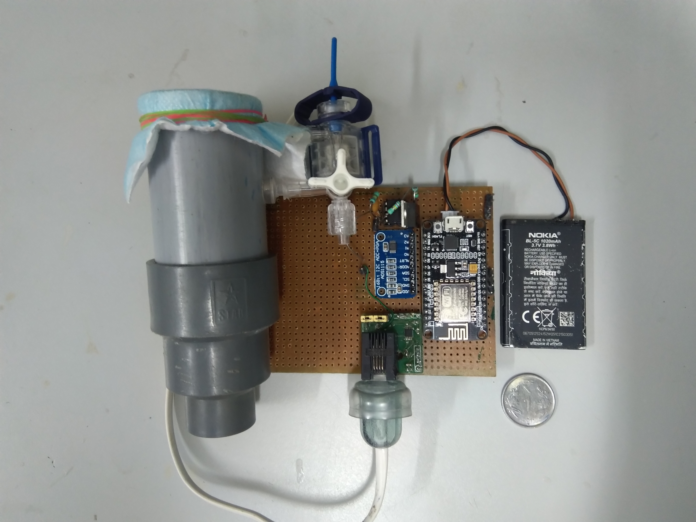
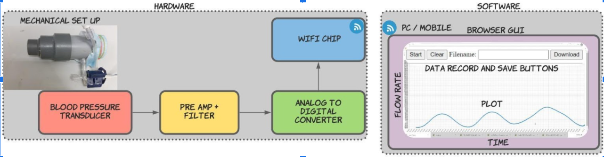
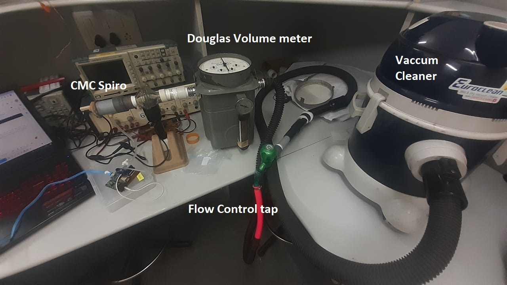
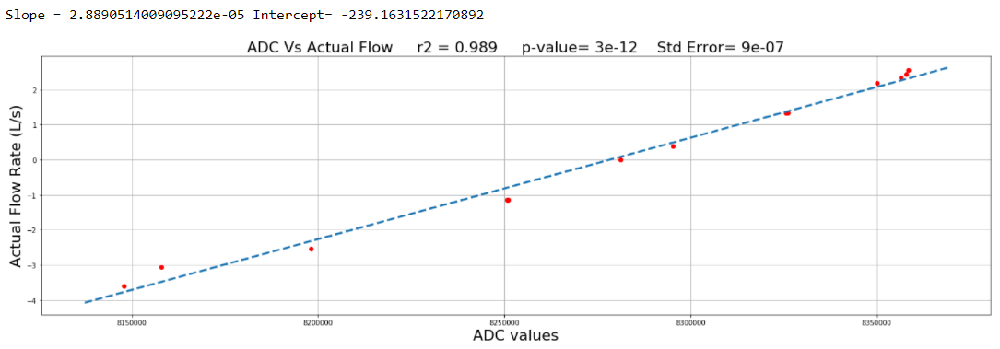

# CMC-Spiro

A low-cost, Wi-Fi spirometer with a disposable flow tube, built in 2020 at the Department of Physiology, Christian Medical College (CMC) Vellore, under Dr. Sathya Subramani and Dr. Suresh R. Devasahayam.

During COVID-19, shared spirometers were an infection risk and were also hard to get. CMC-Spiro uses cheap, hospital-available parts so the part the patient breathes through can be thrown away after each use.



Write-up: [CMC-Spiro: A Low-Cost, Disposable Spirometer Built During COVID](https://timothdev.com/posts/cmc-spiro-low-cost-spirometer/)

## How it works

CMC-Spiro is a **pneumotachograph**. Air flows through a tube with a fine mesh screen across it. The pressure drop across the mesh is proportional to the flow rate, and integrating flow over time gives volume.



**Hardware**

| Part | Role |
| --- | --- |
| PVC flow tube with mesh screen | Creates the pressure drop; disposable |
| Disposable blood pressure transducer | Measures the pressure difference |
| HX711 24-bit ADC | Amplifies and digitises the transducer bridge signal (the first prototype used an ADS1115) |
| ESP8266 (NodeMCU) | Reads the ADC and streams data over Wi-Fi |
| Li-ion phone battery | Portable power |

**Software**

The ESP8266 serves a web page from flash and streams readings to it over a WebSocket. Open the page from any phone or laptop on the same network. It plots flow live (Plotly) and guides a test:

1. **Baseline** (`b`): record the resting signal to remove the zero-flow offset.
2. **Maximal inspiration** (`i`)
3. **Maximal expiration** (`e`): integrates the baseline-corrected flow (trapezoidal rule) and shows volume and duration.
4. **Download** (`d`): save the recording as a text file.

## Calibration

CMC-Spiro was calibrated against a Douglas volume meter, using a vacuum cleaner as the air source and a tap to set the flow rate, in both flow directions.



The raw ADC values were linear with the reference flow (R² = 0.989):



```
flow (L/s) = 2.889e-05 × ADC − 239.16
```

## Repository contents

| File | Description |
| --- | --- |
| `plotly_webserver_1.ino` | ESP8266 firmware: HX711 reading, web server, WebSocket streaming and the browser UI |
| `HX711_.h`, `HX711_.cpp` | HX711 driver |
| `CMC_Spiro.STL`, `magesh_CMCSpiro.step` | 3D model of the flow tube |
| `CMCachitecture.png` | System overview |
| `SpiroCalibrationSetUp.jpeg`, `CalibrationOfBloodPressureTransducer.png` | Calibration setup and results |

## Running it

1. Install the Arduino ESP8266 core and the `WebSockets` library (Markus Sattler).
2. Set your Wi-Fi network name and password in `plotly_webserver_1.ino`.
3. Connect the HX711 to pins `D2` (data) and `D3` (clock), and the transducer to the HX711 input.
4. Flash the ESP8266 and open the IP address printed on the serial monitor (115200 baud).

The browser page loads Plotly from a CDN, so the viewing device needs internet access.

## Disclaimer

This is a research prototype, not a certified medical device. It has not been clinically validated.
